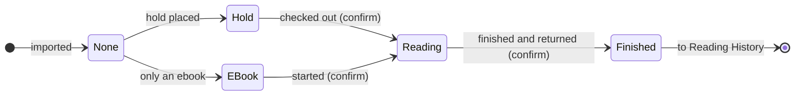

# Wishlist design and Firestore data model

Claude, 2026-10-19. Status: **decided by Sean (2026-10-19)** and built: `tracker/`, `history/`, `firebase/firestore.rules`, `tools/import_wishlist.py`.

Mockup (before the build): [`mockups/wishlist.html`](mockups/wishlist.html). It needs no Firebase.

## 1. Decisions (Sean, 2026-10-19)

- The page is a management portal for the wishlist and the reading history only. Discussion of recommendations stays in LLM chats and in `notes-with-llm/projects/yc-reading`.
- Only books that Sean and YC are interested in go on the wishlist. There are no `Declined` rows.
- Display: option C. Each book shows only the title, the series and number in the series, the author(s), and a status button. The status button opens the status flipper.
- Five status values, in Title case: `None`, `Hold`, `EBook`, `Reading`, `Finished`. The spelling is `EBook`.
- Wishlist order: `Hold`, `EBook`, `None`, then `Reading` at the bottom.
- "Reading" and "Finished" ask for one more confirmation.
- A book that is set to "Finished" leaves the wishlist and goes to the reading history.
- The log button is named "Reading History".
- No loan dates: no `ready` status, no due date, no return date. Reading speed comes later from the reading history.
- Add books: Sean writes them in `notes-with-llm/projects/yc-reading/toWebWishList.md`. Claude imports them with a script when Sean asks.
- Not needed for now: remove a book, edit a book, move a finished book back to the wishlist.

## 2. How status changes

| Status | Meaning | When to set it |
|---|---|---|
| `None` | On the wishlist | The book is imported (the usual start) |
| `Hold` | Hold placed | A physical copy is on hold at the library |
| `EBook` | Only an ebook | The library has no physical copy |
| `Reading` | Checked out | The book is checked out. **Asks to confirm.** Sets `readOn` |
| `Finished` | Finished and returned | **Asks to confirm.** Sets `finishedOn`. The book moves to Reading History |



The flipper allows every status, not only the arrows. The arrows are the usual path. After each change, an "Undo" bar shows for 5 seconds.

## 3. Firestore data model

One document is one book for one reader:

```
readers/{code}/books/{bookId}
```

- `{code}` is `SL`, `CJ`, `YC` or `JY`. `{bookId}` is an automatic ID.
- The wishlist and Reading History use the same documents. "Finished" changes one field. Nothing is copied or deleted.
- The same book on two people's lists is two documents.

| Field | Type | Example | Notes |
|---|---|---|---|
| `title` | text | `Kid Lawyer` | Required. Shown |
| `author` | text | `Black, Holly; Clare, Cassandra` | `Last, First`. More than one author: separate with `; `. Shown |
| `series` | text | `Theodore Boone` | Empty text when not in a series. Shown |
| `seriesNo` | whole number or null | `1` | Shown as `#1` |
| `status` | text | `Reading` | `None`, `Hold`, `EBook`, `Reading` or `Finished`. Shown as the status button |
| `readOn` | date text or null | `2026-10-02` | Set when the status becomes `Reading` (the checkout date) |
| `finishedOn` | date text or null | `2026-10-25` | Set when the status becomes `Finished` (the return date) |
| `addedOn` | date text | `2026-10-19` | Set by the import. Not shown |
| `updatedAt`, `updatedBy` | server time, code | `SL` | Not shown. Records who made the last change (`import` for the import) |

Dates are text (`YYYY-MM-DD`), not Firestore Timestamps. A date-only Timestamp saved at midnight UTC shows as the day before in Vancouver. Text dates sort correctly and are easy to read in the console.

| Page | Shows | Order |
|---|---|---|
| Wishlist (`tracker/?reader=YC`) | Status is not `Finished` | `Hold`, `EBook`, `None`, `Reading`; then series (or title) A to Z; then series number |
| Reading History (`history/?reader=YC`) | Status is `Finished` | Newest `finishedOn` first. Books with no date go last |

The page reads all of one person's books and filters them on the phone. This needs no Firestore index. Changes from another phone show at once.

**Phone in the library.** The pages keep a copy of the books on the phone (Firestore `persistentLocalCache`). With no signal, the list still shows, and status changes are saved when the signal comes back ([Firebase: Access data offline](https://firebase.google.com/docs/firestore/manage-data/enable-offline)).

## 4. Firestore rules (`firebase/firestore.rules`)

| Who | Read | Change status | Add a book | Delete |
|---|---|---|---|---|
| SL, CJ, YC, JY | Every list | Every list. Only `status`, `readOn`, `finishedOn`, `updatedAt`, `updatedBy` | No | No |
| Import account `import@family-reading.invalid` | Every list | No | Yes, with checked fields | No |
| Anyone else, or signed out | No | No | No | No |

- Status must be one of the five values. Dates must be like `2026-10-19`, or null.
- A new book can have only the fields in section 3. There is no "reason" field.
- The Firebase console can still delete or edit a book, because the console does not use the rules.
- Tested with the Firestore emulator: `tests/rules_test.py` (see `tests/README.md`).

## 5. Import (`tools/import_wishlist.py`)

Sean writes the books in `notes-with-llm/projects/yc-reading/toWebWishList.md`, as a Markdown table:

```
| Reader | Title | Series | # | Author(s) | Status |
| --- | --- | --- | --- | --- | --- |
| YC | Kid Lawyer | Theodore Boone | 1 | Grisham, John | |
| YC | The Iron Trial | Magisterium | 1 | Black, Holly; Clare, Cassandra | Hold |
| YC | The Westing Game | — | — | Raskin, Ellen | |
```

- Columns can be in any order. Case does not matter.
- `Status` is optional. Empty means `None`.
- Optional columns `Read on` and `Finished on` (dates like `2026-10-19`), for books that go straight to Reading History.
- `—` or `-` means empty.
- Text before or after the table is ignored, so the file can have notes.
- The `Reader` column is optional when the script gets `--reader YC`. The file in `yc-reading/` has no `Reader` column, so Claude uses `--reader YC` for it.

When Sean asks, Claude runs:

```
python tools/import_wishlist.py ../notes-with-llm/projects/yc-reading/toWebWishList.md --reader YC          # dry run
python tools/import_wishlist.py ../notes-with-llm/projects/yc-reading/toWebWishList.md --reader YC --write  # add
```

- A book that is already in Firestore (same reader, title, series and number) is skipped. So the same file can be imported again, and old rows can stay in the file.
- If one row has a problem (unknown reader, unknown status, no title, a bad number or date), the script lists the lines and adds nothing.
- The script signs in as the import account. The password comes from the environment variable `READS_IMPORT_PASSWORD`, never from the chat or the repo.

## 6. What Sean must do before the app goes live

1. ~~**Publish the rules.**~~ Done (Sean, 2026-10-19). Firebase console → Firestore Database → Rules. Replace the text with `firebase/firestore.rules`, then Publish.
2. ~~**Make the import account.**~~ Done (Sean, 2026-10-19). Firebase console → Authentication → Users → Add user: email `import@family-reading.invalid`, a long random password (not a PIN).
3. **Give the password to the import script.** Claude Code environment settings (the environment menu in the session title bar → Edit) → **Environment variables**: add the line `READS_IMPORT_PASSWORD=<password>`. Put the password in double quotes if it has a `#`. A new session picks it up. Do not paste the password in the chat.
   - Why not a "network secret": the agent proxy adds a network secret to the request *headers*. Firebase sign-in needs the password in the request *body*, so a header secret does not work.
   - Risk: anyone who uses the environment can read the variable. The import account can only read books and add books (Firestore rules), so a leak cannot change or delete books. Sean can reset the password or disable the account in Firebase Authentication at any time.
4. ~~**Make `toWebWishList.md`**~~ Done (Sean, 2026-10-19, 19 books for YC). Then ask Claude to import it.
5. **Ask Claude to merge to `main`** when you want the new pages live.
