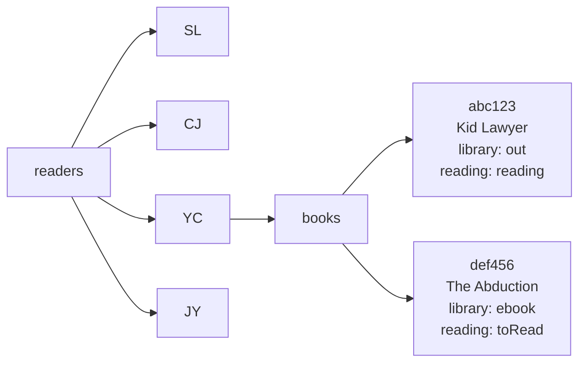
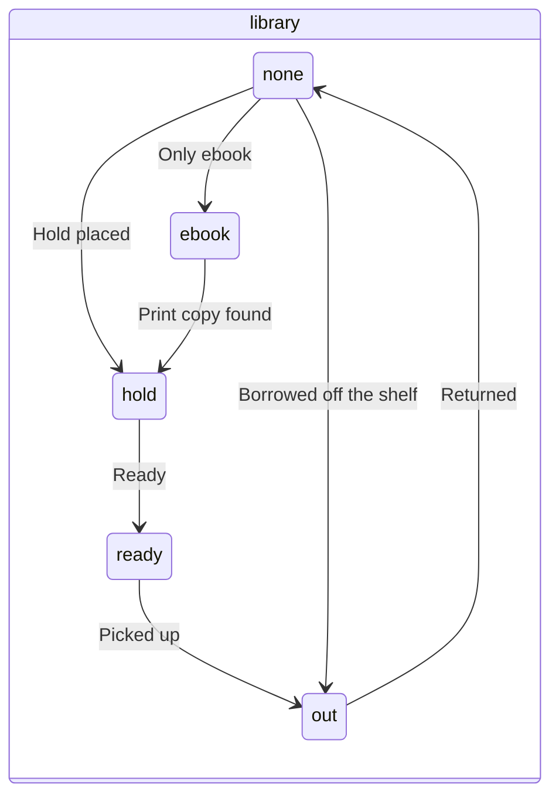
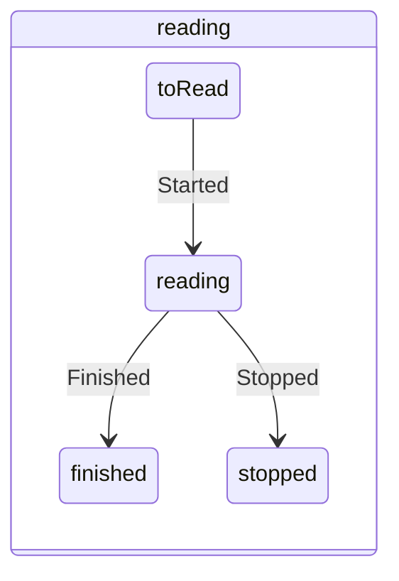

# Proposal: Firestore data model and wishlist options

Claude, 2026-10-19. Status: **proposal, not decided.** Sean decides. No app code is written for this yet.

Mockups: [`mockups/wishlist-options.html`](mockups/wishlist-options.html). Open it with the local test server (`python -m http.server 8000`, then `http://localhost:8000/docs/mockups/wishlist-options.html`), or open the file directly. It needs no Firebase.

## 1. Data model

### Structure

One Firestore document is one book for one reader. The wishlist and the reading log are two views of the same documents. A book moves from the wishlist to the log when one field changes. Nothing is copied or deleted.

```
readers/{code}/books/{bookId}
```

- `{code}` is `SL`, `CJ`, `YC` or `JY`. The `readers/{code}` document itself does not need fields. Firestore allows a subcollection under a document that does not exist.
- `{bookId}` is an automatic Firestore ID.
- The same book on two people's lists is two documents. Each person has a separate library card, hold and loan.



### Fields of a book document

| Field | Type | Example | Notes |
|---|---|---|---|
| `title` | text | `Kid Lawyer` | Required |
| `author` | text | `Grisham, John` | `Last, First`, as in the notes repo |
| `series` | text | `Theodore Boone` | Empty text when not in a series |
| `seriesNo` | number or null | `1` | Book number in the series. Used for order and the series warning |
| `library` | text | `out` | One of `none`, `hold`, `ready`, `out`, `ebook`. See 1.2 |
| `reading` | text | `reading` | One of `toRead`, `reading`, `finished`, `stopped` |
| `holdOn` | date text | `2026-10-11` | Set when `library` becomes `hold` |
| `readyOn` | date text | `2026-10-18` | Set when `library` becomes `ready` |
| `outOn` | date text | `2026-10-02` | Set when `library` becomes `out` |
| `dueOn` | date text | `2026-10-30` | Default: `outOn` + 28 days. Editable |
| `returnedOn` | date text | `2026-10-25` | Set when `library` goes from `out` to `none` |
| `startedOn` | date text | | Set when `reading` becomes `reading` |
| `finishedOn` | date text | | Set when `reading` becomes `finished` or `stopped` |
| `note` | text | | The reader's reaction, for the log. **Not** a reason for the recommendation |
| `addedOn`, `addedBy` | date text, code | `2026-10-19`, `SL` | |
| `updatedAt`, `updatedBy` | server time, code | | Shows who made the last change. Everyone can edit every list |

Empty dates are not stored (the field is missing), or are `null`.

**Why dates are text (`YYYY-MM-DD`), not Firestore Timestamps.** A Timestamp is a moment in time. A date-only value saved as midnight UTC shows as the previous day in Vancouver (UTC−7 or −8). Text dates have no time zone, sort correctly, and are easy to read in the console and in an export. (Informed inference from how JavaScript `Date` handles UTC. Confidence: High.)

### 1.1 Which books show where

| View | Rule |
|---|---|
| Wishlist (the person's page) | `reading` is `toRead` or `reading`, **or** `library` is `hold`, `ready` or `out` |
| Reading log (the button) | `reading` is `finished` or `stopped` |

A book that is finished but not returned shows in both views. It stays on the wishlist until someone taps "Returned", so it is not forgotten.

The page reads all of one person's `books` (about 100 to 200 documents) and filters on the phone. This needs no Firestore index. The free quota is 50,000 reads a day ([Firestore pricing](https://firebase.google.com/docs/firestore/pricing)). (Well-established. Confidence: High.)

### 1.2 Status values and changes

`library` (where the book is):

| Value | Label | Meaning | Today in `suggestions.md` |
|---|---|---|---|
| `none` | Not requested | No hold, no loan | `—` |
| `hold` | On hold | Physical hold placed | `On hold` |
| `ready` | Ready to pick up | The hold is at the branch. **New. Sean to decide** | — |
| `out` | Checked out | Physical book borrowed | `Checked out` |
| `ebook` | EBook only | Only an ebook is in the library. No ebook holds or loans tracked | `EBook` |

`reading` (how far the reader is): `toRead`, `reading`, `finished`, `stopped`.

The two fields are separate. A checkout does not prove the book is read (rule from `llm-rules.md`).





The page allows every change, not only the arrows. The arrows are the usual path.

### 1.3 Rejected alternatives

| Alternative | Why not |
|---|---|
| One document per reader, with a list of all books | Two phones that save at the same time can overwrite each other's changes. Changing one book rewrites the whole list. |
| Separate `wishlist` and `log` collections | "Finished" must move a document: two writes. If one fails, a book is lost or doubled. |
| A history of every status change (an `events` collection) | More code and more reads. The date fields give hold wait time, loan time and reading time for the last loan. Add later if phase 2 needs it. |

### 1.4 Firestore rules (sketch only)

Not written yet. The file will be `firebase/firestore.rules`, tested with the emulator. Sean publishes it. Sketch:

```
match /readers/{code}/books/{bookId} {
  allow read, write: if request.auth != null
    && request.auth.token.email in ['sl@family-reading.invalid', 'cj@family-reading.invalid',
                                    'yc@family-reading.invalid', 'jy@family-reading.invalid']
    && code in ['SL', 'CJ', 'YC', 'JY'];
}
```

Possible addition: on write, allow only the listed `library` and `reading` values. This stops a typo from a bug, not a person.

### 1.5 Phone in the library

- **Weak signal.** The Firestore web SDK can keep a local copy and queue changes while offline (`persistentLocalCache`). The change saves when the signal comes back ([Firebase: Access data offline](https://firebase.google.com/docs/firestore/manage-data/enable-offline)). (Well-established. Confidence: High.) Recommend: turn it on.
- **Wrong tap.** Every change shows an "Undo" bar for 5 seconds. All three mockups have it.

### 1.6 Import from the notes repo (later, one time)

| `suggestions.md` | Firestore |
|---|---|
| `Status / feedback`: `To consider`, `Interested` | `reading: toRead` |
| `In progress` | `reading: reading` |
| `Read` | `reading: finished` |
| `Declined` | Not imported (see question 2) |
| `Library status` | `library`, as in table 1.2 |
| `Why it may fit`, `Suggested by` | Not imported. Decision 2026-10-16: no reason field |

`reading-log.md` rows become `reading: finished`, with no dates (the dates are not known).

## 2. Wishlist options on a phone

All three options show the same data and use the same model. They differ in how the list is grouped and how many taps a change takes. The mockup page has all three. Every tap target is at least 44 px.

| | A · Next step | B · Series + switch | C · List + sheet |
|---|---|---|---|
| Grouped by | Library status: Ready, Out, Hold, EBook, Not requested | Series, in book order; then other books | One list, sorted Ready, Out, Hold, EBook, Not requested |
| Usual change (hold → ready → out → returned) | **1 tap** ("Picked up", "Returned") | **1 tap** on the switch | 2 taps (book, then status) |
| Other change (for example to EBook) | 2 taps (⋯, then status) | 1 tap | 2 taps |
| Change reading status | In the ⋯ panel | Not on the list (needs a panel too) | In the panel |
| Series order visible | Partly (series and number on each row) | **Yes**, best | Partly |
| Screen space for each book | Medium | Large (switch on every row) | **Small** |
| What to do in the library | **Clear**: top sections are "Ready to pick up" and "Checked out" | Must look for the coloured parts | Clear (sorted), but 2 taps |
| Risk of a wrong tap | Low (one labelled button) | Higher (5 small parts on every row, while scrolling) | Lowest |

```
A · Next step                 B · Series + switch           C · List + sheet
┌──────────────────────────┐  ┌──────────────────────────┐  ┌──────────────────────────┐
│ YC's wishlist  [Log →]   │  │ YC's wishlist  [Log →]   │  │ YC's wishlist  [Log →]   │
│ ● READY TO PICK UP (1)   │  │ THEODORE BOONE           │  │ Wild Robot Protects [Rdy]│
│ Wild Robot [Picked up][⋯]│  │ 1. Kid Lawyer            │  │ Kid Lawyer          [Out]│
│ ● CHECKED OUT (4)        │  │ [—|Hold|Ready|OUT|eBook] │  │ Angel              [Hold]│
│ Kid Lawyer  [Returned][⋯]│  │ 2. The Abduction         │  │ The Abduction      [eBk] │
│ ● ON HOLD (4)            │  │ [—|Hold|Ready|Out|EBOOK] │  │   tap a book ↓           │
│ Angel       [Ready]   [⋯]│  │ 3. The Accused   ...     │  │ ┌ panel: 5 big buttons ┐ │
└──────────────────────────┘  └──────────────────────────┘  └──────────────────────────┘
```

**Recommendation: A.** The stated need is fast status changes on an iPhone in the library. A puts the books to act on at the top and makes the usual change one tap. (Informed inference. Confidence: Low to Moderate. No test with Sean or YC yet. A 5-minute try of the mockup on Sean's iPhone in the library would change or confirm this.)

The series warning ("⚠ Book 1 not finished yet") can show in all three options. To see it in the mockup, open B and set *The Abduction* to Out.

## 3. Questions for Sean

1. Which option: A, B, C, or a mix (for example A, with B's series grouping as a second tab)?
2. The 2026-10-13 rows from Claude are `To consider`. Are they on the wishlist (chosen), or still recommendations? And should `Declined` rows be imported?
3. Add the `ready` status ("Ready to pick up")? It is not in `llm-rules.md` today.
4. `llm-rules.md` says: no due dates, return dates or extra library fields. The app needs dates for loans and reading speed. When the app becomes the source of truth, that rule must change. OK?
5. BPL renews loans automatically, up to 2 times, unless another person has a hold. The app cannot see renewals. Keep `dueOn` as "first due date", and show "can renew to" (+56 days)? Or let people edit `dueOn`?
6. Order inside the wishlist: is "what to borrow next" needed now (a priority number), or later in phase 2?
