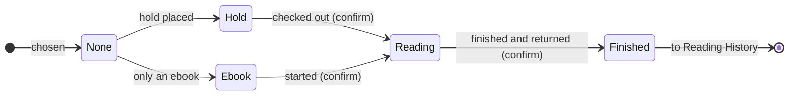

# Wishlist design and Firestore data model

Claude, 2026-10-19. Status: **decided by Sean (2026-10-19)**, except the open questions in section 4. The tracker page is not built yet.

Mockup: [`mockups/wishlist.html`](mockups/wishlist.html). Open it with the local test server (`python -m http.server 8000`, then `http://localhost:8000/docs/mockups/wishlist.html`), or open the file directly. It needs no Firebase.

## 1. Decisions (Sean, 2026-10-19)

- The page is a management portal for the wishlist and the reading history only. Discussion of recommendations stays in LLM chats and in `notes-with-llm/projects/yc-reading`.
- Only books that Sean and YC are interested in go on the wishlist. There are no `Declined` rows.
- Display: option C. Each book shows only the title, the series and number in the series, the author(s), and a status button. The status button opens the status flipper.
- Five status values, in Title case: `None`, `Hold`, `Ebook`, `Reading`, `Finished`.
- "Reading" and "Finished" ask for one more confirmation.
- A book that is set to "Finished" leaves the wishlist and goes to the reading history.
- The log button is named "Reading History".
- No loan dates: no `ready` status, no due date, no return date. Reading speed comes later from the reading history.

## 2. How status changes

| Status | Meaning | When to set it |
|---|---|---|
| `None` | On the wishlist | The book is chosen from the recommendations |
| `Hold` | Hold placed | A physical copy is on hold at the library |
| `Ebook` | Only an ebook | The library has no physical copy |
| `Reading` | Checked out | The book is checked out. **Asks to confirm.** Sets `readOn` |
| `Finished` | Finished and returned | **Asks to confirm.** Sets `finishedOn`. The book moves to Reading History |



The flipper allows every status, not only the arrows. The arrows are the usual path. After each change, an "Undo" bar shows for 5 seconds.

## 3. Firestore data model

One document is one book for one reader:

```
readers/{code}/books/{bookId}
```

- `{code}` is `SL`, `CJ`, `YC` or `JY`. `{bookId}` is an automatic Firestore ID.
- The wishlist and Reading History use the same documents. "Finished" changes one field. Nothing is copied or deleted.
- The same book on two people's lists is two documents.

| Field | Type | Example | Notes |
|---|---|---|---|
| `title` | text | `Kid Lawyer` | Required. Shown |
| `author` | text | `Black, Holly; Clare, Cassandra` | `Last, First`. More than one author: separate with `; `. Shown |
| `series` | text | `Theodore Boone` | Empty text when not in a series. Shown |
| `seriesNo` | number or null | `1` | Shown as `#1` |
| `status` | text | `Reading` | `None`, `Hold`, `Ebook`, `Reading` or `Finished`. Shown as the status button |
| `readOn` | date text | `2026-10-02` | Set when the status becomes `Reading` (the checkout date) |
| `finishedOn` | date text | `2026-10-25` | Set when the status becomes `Finished` (the return date) |
| `addedOn` | date text | `2026-10-19` | Not shown. Keeps the order of new books |
| `updatedAt`, `updatedBy` | server time, code | `SL` | Not shown. Everyone can edit every list, so this records who made the last change |

Dates are text (`YYYY-MM-DD`), not Firestore Timestamps. A date-only Timestamp saved at midnight UTC shows as the day before in Vancouver. Text dates sort correctly and are easy to read in the console.

Removed from the proposal (Sean, 2026-10-19): the `reading` field, the `ready` status, `holdOn`, `readyOn`, `outOn` (same as `readOn`), `dueOn`, `returnedOn` (same as `finishedOn`), `startedOn` (same as `readOn`) and `note`.

| Page | Shows | Order |
|---|---|---|
| Wishlist (`tracker/?reader=YC`) | Status is not `Finished` | `Reading`, `Hold`, `Ebook`, `None`; then series (or title) A to Z; then series number |
| Reading History | Status is `Finished` | Newest `finishedOn` first. Imported books with no date go last |

The page reads all of one person's books (about 100 to 200 documents) and filters them on the phone. This needs no Firestore index.

### Firestore rules (plan)

The file will be `firebase/firestore.rules`, tested with the Firestore emulator. Sean publishes it in the Firebase console.

- Allow read and write on `readers/{code}/books/{bookId}` only when the email is one of the four accounts, and `code` is `SL`, `CJ`, `YC` or `JY`.
- On write, allow only the five status values, and require `title` to be text.

### Phone in the library

The Firestore web SDK can keep a local copy and queue changes while offline (`persistentLocalCache`). The changes save when the signal comes back ([Firebase: Access data offline](https://firebase.google.com/docs/firestore/manage-data/enable-offline)). Plan: turn it on.

### Import from `notes-with-llm` (one time, later)

| `suggestions.md` | Firestore `status` |
|---|---|
| `Library status` `On hold` | `Hold` |
| `Library status` `EBook` | `Ebook` |
| `Library status` `Checked out`, or `Status / feedback` `In progress` | `Reading` (no `readOn`) |
| `Library status` `—`, `Status / feedback` `To consider` or `Interested` | `None` |
| `Status / feedback` `Read` | `Finished` |
| `Status / feedback` `Declined` | Not imported |

`reading-log.md` rows with `Finished` become `Finished` books with no dates. `Why it may fit` and `Suggested by` are not imported.

## 4. Open questions for Sean

1. **Add a book.** How do new books get on the wishlist: an "Add book" form on the page, an import that Claude runs from `suggestions.md`, or both?
2. **Remove a book.** Do you need a "Remove from wishlist" choice in the flipper, for a book you are no longer interested in?
3. **Edit a book.** Do you need to fix a title, author or series number on the page, or only in the Firebase console?
4. **Reading History.** Can a finished book move back to the wishlist (for a wrong "Finished" after the Undo bar is gone)?
5. **Source of truth.** When the app is live, does it replace `suggestions.md` and `reading-log.md` for status? If yes, `llm-rules.md` in `notes-with-llm` must change.
